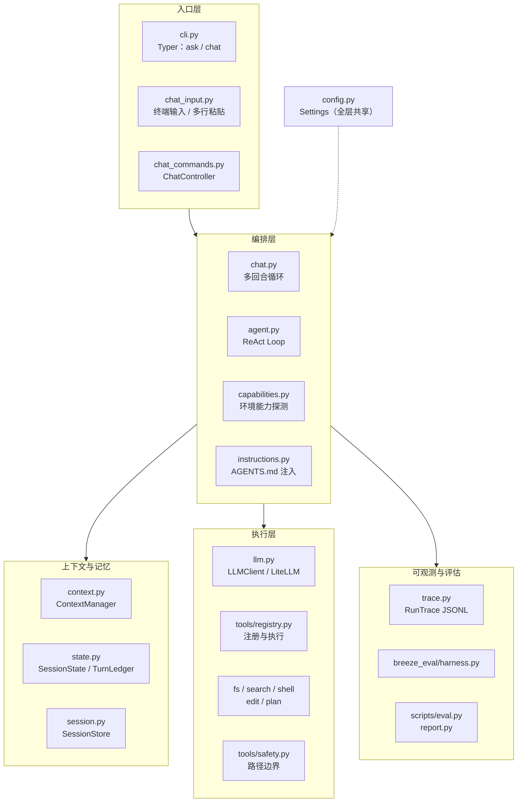
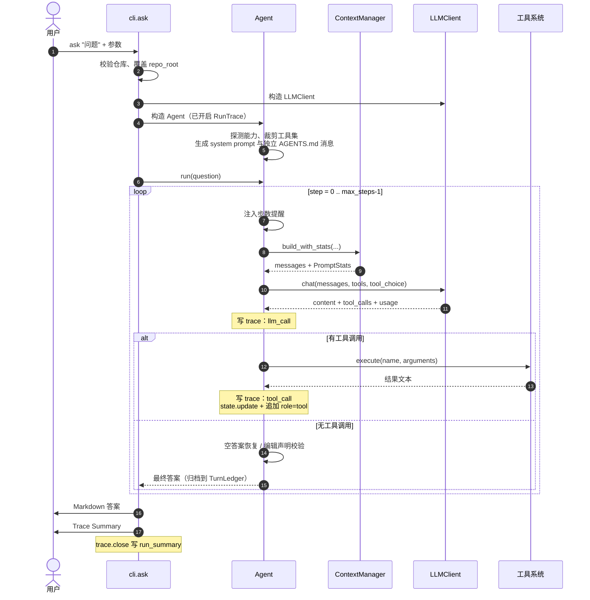
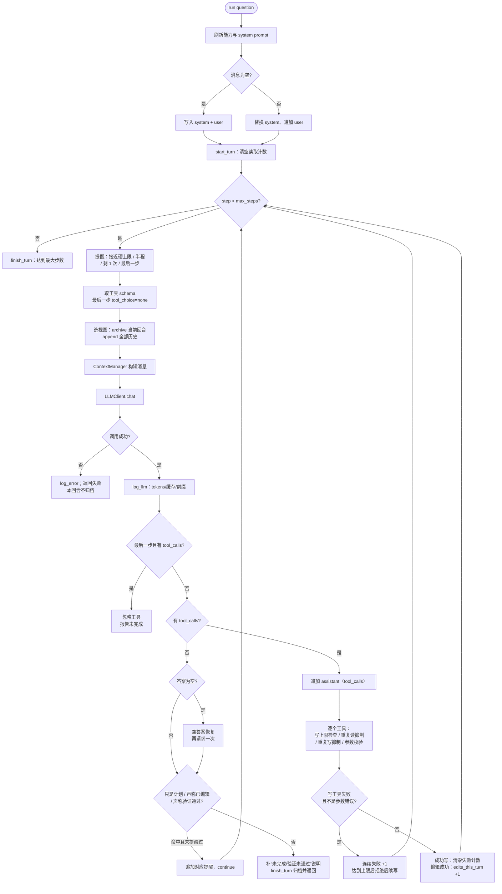
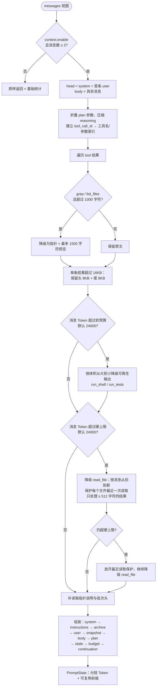
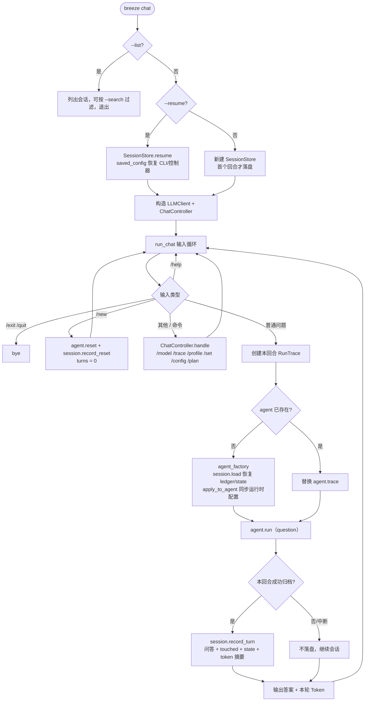
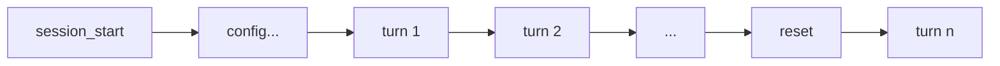
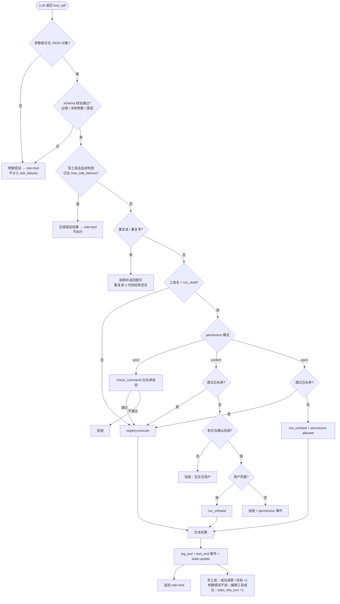
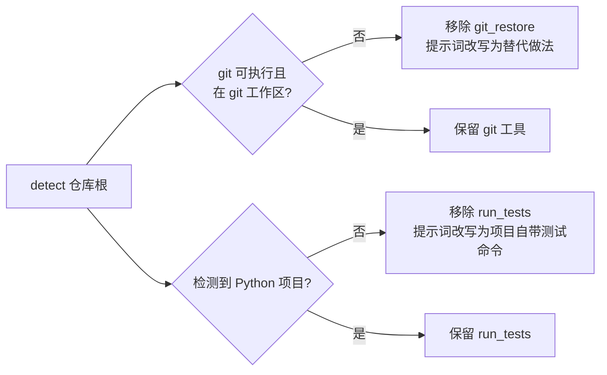
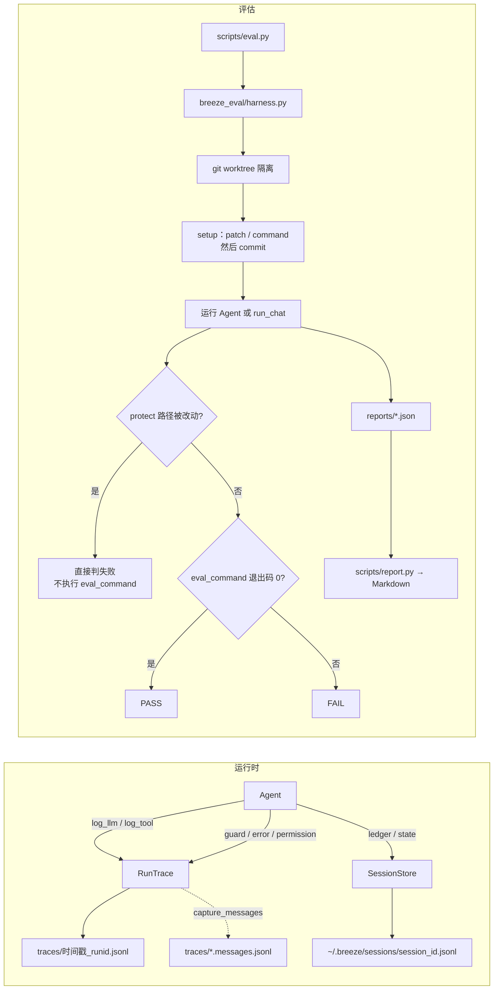
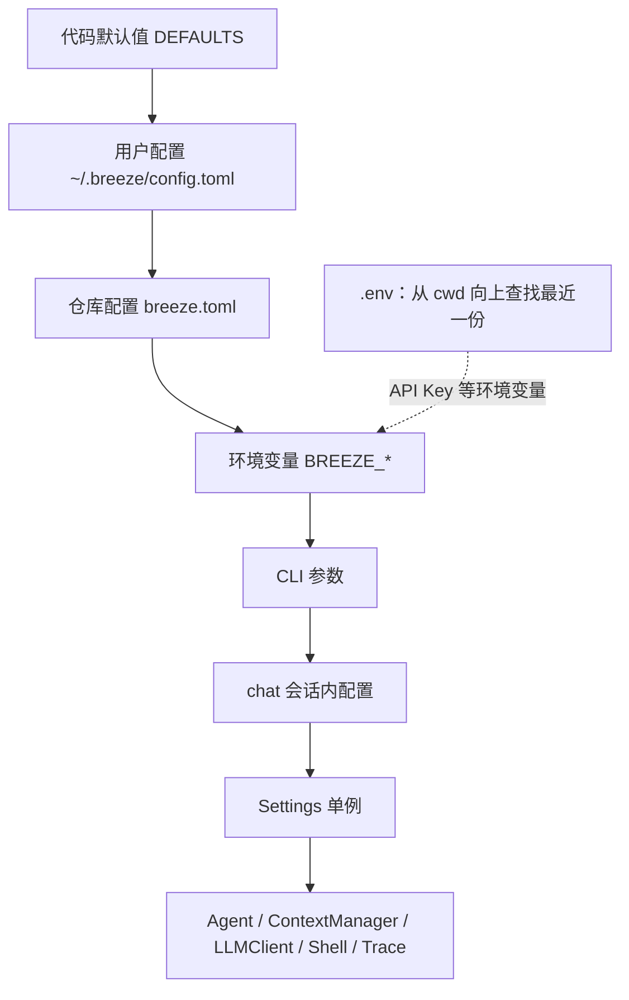

# Breeze 架构与流程

> 基于当前源码整理，不绑定具体版本号。行为变更时同步更新本文；与代码不一致时
> 以 `src/breeze/` 为准。README 里标为“计划中”的 Hybrid Retriever、小模型路由、
> Semantic Cache 未画入主链路。

## 1. 一句话架构

Breeze 是单 Agent 的 CLI 代码助手：**CLI 负责入口与会话，Agent 负责 ReAct 循环，
ContextManager 负责把“当前回合”压进 Token 预算，SessionState/TurnLedger 负责跨压缩、
跨回合保留事实，Tool System 负责受控执行，RunTrace 负责全程可观测。**

```text
breeze ask ──> cli.ask ──> Agent.run ──┬─> ContextManager.build_with_stats ──> LLMClient
                                       ├─> Tool Registry ──> fs / search / shell / edit
                                       ├─> SessionState.update（每次工具结果后）
                                       └─> TurnLedger.record（回合结束时）
                                                  │
                                                  └─> RunTrace（JSONL）
```

## 2. 分层组件图



> 箭头表示层间依赖方向，具体调用关系见后续时序图与流程图。
> 各层内部的模块对应关系见下方职责表。

### 模块职责速查

| 文件 | 核心对象 | 职责 | 关键约束 |
|---|---|---|---|
| `cli.py` | `ask` / `chat` | 解析参数、切换 `settings.repo_root`、渲染答案与摘要 | 不需要模型的命令不校验 API Key |
| `chat.py` | `run_chat` | 多回合输入循环、每回合 trace、会话恢复与落盘 | 与 CLI 解耦，依赖可注入 |
| `chat_commands.py` | `ChatController` | 运行中改模型/预算/权限/trace，写 config 事件 | 配置变更可被 `--resume` 恢复 |
| `agent.py` | `Agent` | ReAct 主循环、步数提醒、编辑失败上限、空答案恢复 | 默认 25 步、连续编辑失败 3 次 |
| `context.py` | `ContextManager` | 软/硬预算、按工具类别降级、前缀复用统计 | 软预算不动 `read_file` |
| `state.py` | `SessionState` / `TurnLedger` | 从真实工具结果提取事实；跨回合归档问答结论 | 不采信模型自述 |
| `session.py` | `SessionStore` | append-only JSONL，恢复 ledger/state/config | 空会话不落盘 |
| `llm.py` | `LLMClient` | LiteLLM 调用、超时重试、参数不兼容回退、用量提取 | API Key 只来自环境变量 |
| `trace.py` | `RunTrace` | `run_start / llm_call / tool_call / guard / permission / run_summary` | 每回合或固定文件追加 |
| `tools/registry.py` | `TOOLS` | 装饰器注册、schema 导出、按名执行、参数校验 | 名称全局唯一；参数错误抛 `ToolArgumentError` |
| `tools/safety.py` | `safe_path` | 仓库边界；`.env*`/`.git/` 读取保护 | 写操作只能用 `safe_path` |
| `tools/fs.py` | `list_files` / `read_file` | 目录浏览、带行号读取、`start_line/end_line` 定点读 | 忽略缓存/构建目录与 `.gitignore` |
| `tools/search.py` | `grep` | `文件:行号:内容`；rg 优先，Python 回退 | 结果行数与字节双上限 |
| `tools/shell.py` | `run_shell` | `shell=False`、可执行文件/子命令/选项白名单 | 拒绝未加引号的串联/管道/重定向 |
| `tools/edit.py` | 5 个工具 | 单点替换、建文件、删路径、回滚、pytest | 补丁大小、受保护路径、原子写入 |
| `tools/plan.py` | `update_plan` | 计划写入 `SessionState.plan` | 最多 2000 字符 |
| `capabilities.py` | `detect` | 按环境裁剪工具集与提示词 | 写操作后可能重新探测 |
| `instructions.py` | AGENTS.md | 仓库级指引作为独立 system 消息注入 | 最多 8000 字符，不能放宽安全规则 |
| `config.py` | `settings` | 默认值 → 用户 → 仓库 → 环境变量 → CLI 合并 | 安全白名单不可配置 |

## 3. 单轮 `breeze ask` 时序



> `run_shell` 是特例：`Agent._execute_shell` 先按权限模式判定，再调用
> `registry.execute("run_shell", ...)` 或 `shell.run_unlisted(...)`。

## 4. ReAct 主循环



关键计数规则：

- `edits_this_turn`：`apply_patch`、`create_file`、`delete_path`、`git_restore` 成功才 +1，用于半程提醒和“声称已编辑”校验。
- `edit_failures`：只统计三个写工具（`apply_patch`、`create_file`、`delete_path`）的连续失败；成功一次清零，达到 `max_edit_failures` 后拒绝后续写操作。
- **参数错误不计入 `edit_failures`**：漏传必填项、未知参数、类型不符、参数不是合法 JSON 都只返回可修正的说明，模型改对后可直接重试。
- 工具成功与否按结果前缀判断：`Error`、`Tool execution failed`、`Failed` 视为失败。
- `apply_patch` / `create_file` 失败时结果追加 `No changes were written to the target path.`，避免模型为确认而重读；`delete_path` 可能部分删除，不加该断言。
- 同一路径的 `read_file` 在副本仍可见时被连续抑制 3 次，会直接结束回合并报告未完成；同一写调用成功后再原样重复会被抑制。

## 5. 上下文构建（ContextManager）

### 5.1 消息注入顺序

```text
system        默认提示 + 运行环境说明
instructions  AGENTS.md（独立 system 消息，非空时）
archive       TurnLedger 渲染的已完成回合（仅 archive 模式）
user          当前回合问题（append 模式下是整个会话首问）
snapshot      跨回合工作集快照（仅回合第一步且存在历史）
body          assistant ↔ tool 的完整往返
plan          update_plan 的当前计划（非空时）
state         SessionState（降级或回合启动时注入完整状态；
              未降级时只注入本回合重复读取警示）
budget        剩余预算与仍可见的 read_file 工作集（每轮）
continuation  最后一条是 system 时补的短 user 消息
```

`plan` 与 `state` 放在末尾，是为了让计划/索引变化不切断前面的缓存前缀；
`state` 的完整块只在发生降级或回合启动时注入，未压缩回合只保留重复读取提醒，
避免占用预算或把历史读取计数误当成当前事实。`budget` 块随剩余预算变化，
因此放在 `state` 之后、`continuation` 之前。

### 5.2 两级预算与降级流程



五个设计点：

1. **软预算不动文件原文**：`read_file` 是 `apply_patch` 的 `old` 来源，换出后模型只能重读，既多花 Token 又切断缓存。
2. **定位类结果保留预览**：`grep`/`list_files` 整块丢弃会让模型只剩“重跑”一个选择。
3. **大结果优先降级**：小结果换出省不下多少 Token，却迫使模型重读，收益为负。
4. **读取按旧到新降级**：新读到的内容优先留在上下文里，否则模型会陷入“读取→被压缩→立刻重读”的循环。已被降级的旧读取若有更新的可见副本，指针会改为指向该副本而不是要求重读全文件。
5. **降级决策保持稳定**：同一 tool_call_id 一旦降级就不再还原，即使下一轮总量暂时低于预算；软阶段一次降到预算的 85%，减少“每步降一条、每步改一次 body”的抖动。两者都是为了保护 body 中部的前缀缓存。

### 5.3 缓存前缀统计

`ContextManager._stats()` 对每条消息做 `blake2b` 指纹，与上一次 build 逐条比较，
相同前缀的 Token 计入 `cacheable_prefix_tokens`。它统计的是**消息本身**，不含工具 schema；
provider 返回的 `prompt_tokens` 通常更大，两者差额就是 schema 与格式开销。

## 6. 多回合 `breeze chat`

### 6.1 会话主循环



### 6.2 会话文件事件模型



| 事件 | 写入时机 | 内容 |
|---|---|---|
| `session_start` | 首个回合落盘前 | session_id、repo_root、model、创建时间 |
| `config` | `/model` `/trace` `/profile` `/set` | 变更键值；`--resume` 时合并最后一份 |
| `turn` | 回合正常结束 | 问题、答案、touched、tokens、trace 路径、`SessionState` 快照 |
| `reset` | `/new` | 恢复时只认最后一个 reset 之后的内容 |

存储选择 append-only JSONL：与 trace 同族、零依赖、人可读、坏行可跳过。
没有跑过回合的会话不会留下空文件，避免污染 `--list` 与 `--resume latest`。

### 6.3 跨回合记忆

| 结构 | 保留什么 | 丢弃什么 | 作用 |
|---|---|---|---|
| `TurnLedger` | 问题（单行折叠）、答案原文（受预算）、触碰文件 | 历史工具调用与中间输出 | 下一回合只看到“结论” |
| `SessionState` | 符号位置、最近读取范围、编辑结果、测试摘要、计划 | 本回合读取计数（不落盘） | 降级后仍能定点重读/编辑 |
| `SessionStore` | 两者的持久化快照 | trace 级细节 | 进程退出后可 `--resume` |

## 7. 工具执行与权限



参数校验在 `registry.execute` 入口完成：必填项缺失、未知参数、类型不符会抛
`ToolArgumentError`，Agent 转成带 `Expected:` 列表的错误结果，并明确写工具没有
写入目标文件。这样模型能直接修正参数，而不是面对一句 `TypeError` 再盲目重试。

三种权限模式都保留的边界：

- `shell=False`，一次只执行一条命令；未加引号的 `; | & < >` 一律拒绝。
- `cwd` 必须落在仓库内；超时默认 180 秒；stdout/stderr 各按预算截断。
- 可执行文件白名单：`git`、`node`、`rg`、`python`、`python3`、`where`；
  git 子命令、Python 模块、危险选项另有黑名单。
- 路径统一经过 `safe_path`（写）或 `safe_read_path`（读）；`.git/` 与 `.env*`
  禁止读写（`.env.example` / `.env.sample` 例外），写工具还额外保护仓库内的
  trace 目录。

### 7.1 工具集按环境裁剪



`_refresh_capabilities_after_write()` 只在当前缺少 Python 项目时重新探测，
因为写操作可能刚创建 `pyproject.toml` 等标记；能力变化会同步工具集与 system prompt。

## 8. Trace 与评估



Trace 事件类型：

| 事件 | 关键字段 | 用途 |
|---|---|---|
| `run_start` | run_id、ts | 标记文件起点 |
| `llm_call` | step、model、tokens、cache、cost、latency、prompt_breakdown、cacheable_prefix | Token 与缓存分析 |
| `tool_call` | tool、arguments、result_preview、error、latency | 工具行为复盘；异常和 `Error`/`Failed` 字符串结果都会写入 `error` |
| `guard` | step、message | 自检拦截（空答案、计划式回答、无编辑声明、验证声明不符、上下文收敛、重复读/写抑制、最后一步工具被忽略） |
| `permission` | command、decision、mode | 命令审计 |
| `error` | step、message | 非工具错误（主要是 LLM 调用失败） |
| `run_summary` | 汇总计数 | 与 `trace.summary()` 一致 |

评估的评分只看 `eval_command` 退出码与 `protect` 路径是否干净，不看模型自述；
`--repeat N` 取 Token 中位数并记录按 run 通过率。

## 9. 配置与启动顺序



- `.env` 只用于环境变量；API Key 永不写入配置文件。
- 压缩档位 `short / medium / long / custom` 是默认值之上的一层：
  显式配置与环境变量仍覆盖档位。
- 安全白名单、受保护路径、补丁/diff/测试输出上限、schema 默认值不开放配置。

## 10. 关键默认值与边界

| 项 | 默认值 | 位置 |
|---|---:|---|
| 最大循环步数 | 25 | `config.DEFAULTS.agent.max_steps` |
| 连续编辑失败上限 | 3 | `config.DEFAULTS.agent.max_edit_failures` |
| 回合软预算 | 24000 tokens | `config.DEFAULTS.context.intra_turn_budget` |
| 回合硬上限 | 24000 tokens | `config.DEFAULTS.context.hard_budget` |
| 单条工具结果上限 | 16000 bytes | `context.tool_result_max_bytes` |
| grep 结果行数 | 100 | `search.DEFAULT_MAX_RESULTS` |
| list_files 条目 / 单目录文件 | 200 / 20 | `fs.DEFAULT_MAX_ENTRIES` / `DEFAULT_MAX_FILES_PER_DIR` |
| 补丁 old/new | 20000 bytes、200 行差 | `edit.MAX_PATCH_BYTES` / `MAX_PATCH_LINES` |
| create_file 内容 | 50000 bytes | `edit.MAX_CREATE_BYTES` |
| run_tests 测试输出 | 8000 bytes | `edit.MAX_TESTS_OUTPUT_BYTES` |
| run_shell 超时 | 180 s | `shell.DEFAULT_TIMEOUT_SECONDS` |
| run_tests 超时 | 240 s | `edit.TESTS_TIMEOUT_SECONDS` |
| LLM 超时 / 连接超时 / 重试 | 600 s / 15 s / 2 | `config.DEFAULTS.llm` |
| 计划长度 | 2000 字符 | `state.PLAN_MAX_CHARS` |
| AGENTS.md 长度 | 8000 字符 | `instructions.MAX_INSTRUCTIONS_CHARS` |

## 11. 扩展点

- **新增工具**：在 `src/breeze/tools/` 下用 `@register(name=..., description=..., parameters=...)`
  注册，函数返回字符串；若依赖环境能力，在 `capabilities.py` 增加探测并在
  `agent._enabled_tool_names()` 裁剪。
- **调整压缩策略**：改 `ContextManager` 的 `POINTER_TOOLS`、`SPILL_TOOLS`、
  `READ_SPILL_MIN_CHARS`，或通过 `[context]` / 压缩档位改预算。
- **新增会话内命令**：在 `ChatController.handle()` 增加分支，配置变更走
  `self._record(...)` 以便 `--resume` 恢复。
- **新增评估任务**：在 `tasks/quality.yaml` 加任务，先跑
  `python scripts/check_tasks.py --suite core` 确认“修复前失败、protect 干净”。

## 12. 已知边界

- 编辑正确性仍受模型能力限制：自述“已完成”与真实写入可能不一致，
  代码层用“无成功编辑则再提醒一次”兜底，但不能替代模型推理。
- 上下文按消息 Token 估算，不含工具 schema；硬上限应配置在模型上下文以内。
- 降级会改写 body 中部消息，被改写位置之后的前缀缓存全部失效；因此压缩回合的
  缓存命中率会低于 append-only，这是用预算换正确性的代价。已降级结果在后续
  build 中保持指针形态，避免预算回落时又还原成原文。
- `reasoning_content` 只保留最新一步全文，更早的会被截断；截断发生在旧消息上，
  会使该位置之后的前缀失效。真实 trace 中这是主要的缓存失分来源，限制为一条
  已把失配范围缩到最近一步。
- 参数校验只覆盖必填项、未知键与 JSON 基础类型，不校验取值范围或语义合法性。
- `append` 模式只用于成本对照，上下文会持续增长。
- 多回合只保留问答结论与结构化索引，不保留完整工具过程；需要精确原文时
  只能重新读取。
